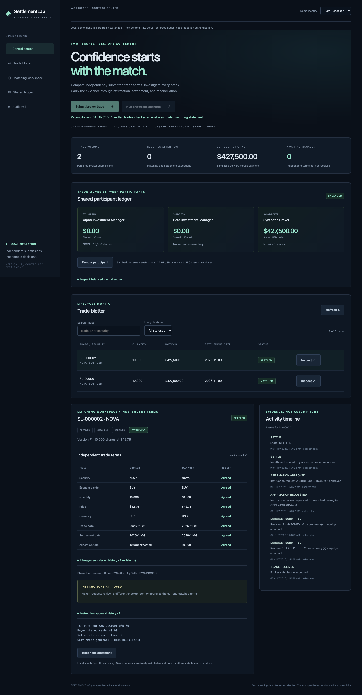
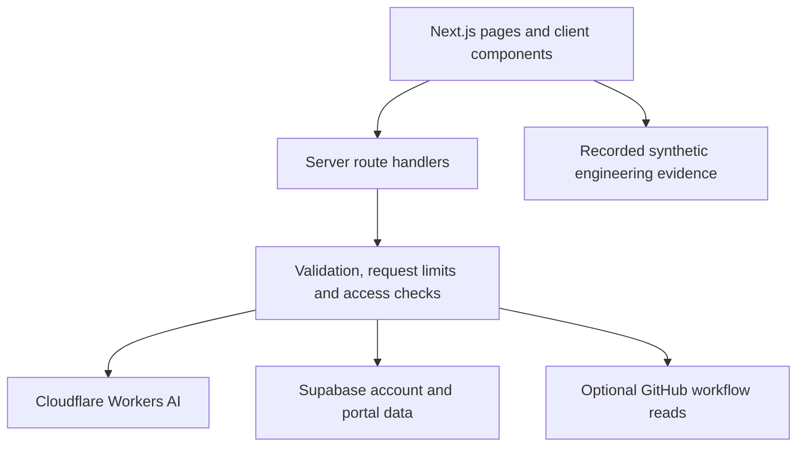

# eAI Engineering

An independent engineering portfolio and AI learning platform by **Erdal Kilic, Senior SDET / QA Automation Engineer**. The project combines interactive learning tools, an engineering assistant, and case studies backed by executable automation projects.

[Live website](https://www.eai.engineering) · [Engineering Studio](https://www.eai.engineering/engineering) · [Learning Studio](https://www.eai.engineering/study) · [Setup](docs/LOCAL_SETUP.md) · [Contributing](CONTRIBUTING.md)

## Explore the work

| Experience | What to inspect |
|---|---|
| [Engineering Studio](https://www.eai.engineering/engineering) | Guided financial, commerce and healthcare failure/recovery stories with recorded execution evidence |
| [SettlementLab](https://www.eai.engineering/engineering/settlementlab#showcase-v30) | Python financial assurance, shared-ledger settlement and independent-service reuse; [source](https://github.com/kilicerdal/settlementlab) |
| [Order Once](https://www.eai.engineering/engineering/order-once) | Commerce retry, stock and duplicate-operation investigation |
| [Claim Twice](https://www.eai.engineering/engineering/claim-twice) | Healthcare message redelivery and processing controls |
| [Learning Studio](https://www.eai.engineering/study) | AI tutoring, plans, linked materials, lesson checks, practice and a mistake notebook |
| [Writing Studio](https://www.eai.engineering/study/writing) | Draft feedback, argument/structure analysis and rate-limit handling |
| [Engineering assistant](https://www.eai.engineering/chat) | Coding, testing, debugging and review conversations |

[](https://www.eai.engineering/engineering/settlementlab)
*Recorded V2.2 financial console shown in the Engineering Studio. Current V3.0 execution reports are linked from the case study. This repository hosts the presentation; the financial framework has its own repository.*

## Run locally

Use **Node.js 24.x** (see [.nvmrc](.nvmrc)) and npm. Core pages, deterministic tests and the production build need no AI credentials. Live integrations require your own configured services.

```sh
nvm use                 # if you use nvm; otherwise select Node 24 directly
npm ci
npm run dev
```

Open http://localhost:3000. Optional integrations are documented in [local setup](docs/LOCAL_SETUP.md), with a blank [.env.example](.env.example). Do not copy production credentials into a public issue, test fixture or screenshot.

## Verify the repository

```sh
npm test                # all top-level Node test files, including recruiter and engineering controls
npm run lint
npm run typecheck       # generate Next route types, then run TypeScript without emit
npm run build
# Or run the four checks in order:
npm run check
```

Tests use injected/local fixtures and do not require live model calls. These are separate from browser checks:

```sh
npx playwright install chromium
npm run test:engineering-browser
npm run test:study-layout
```

Browser configuration starts a local development server on 127.0.0.1:3040 and records failure traces/screenshots. It must not target production for write operations. Some historical evidence under docs/ and public/evidence/ records earlier runs; those records are not results of the command you just executed.

The [repository quality workflow](.github/workflows/quality.yml) runs Node tests, lint, type checking and a production build with read-only repository permissions and no service credentials. It does not deploy. Vercel deployment is a separate existing integration; pushing a branch can still trigger that integration independently.

## Architecture and boundaries



| Area | Location |
|---|---|
| Pages and server routes | src/app/ |
| Interface components | src/components/ |
| Pure policies, contracts and adapters | src/lib/ |
| Node and browser checks | tests/ |
| Case-study evidence and images | public/evidence/, public/images/ |
| Design records and setup details | docs/ |

Cloudflare and privileged service credentials stay server-side. Public Supabase settings use NEXT_PUBLIC names intentionally; they are not authorization. Provider setup, database row policies and invitation/session checks have their own requirements. See [security boundaries](SECURITY.md) and [account setup](docs/study-account-setup.md).

Failure-log analysis performs best-effort redaction before sending text to the model. This does not guarantee removal of every possible sensitive format. Use synthetic logs; never submit credentials or confidential financial/health records. AI output is advisory and does not establish correctness. Detailed AI-generated test execution, coverage intelligence and broader repository-health workflows remain development areas, not completed enterprise capabilities.

## Stack

Next.js App Router, React, TypeScript, Tailwind CSS, Cloudflare Workers AI, Supabase, Upstash, Node's test runner, Playwright and Vercel. Versions are recorded in package.json and package-lock.json.

## Project status and ownership

Active development. I design and maintain the interface, server-side integrations, learning workflows, case-study presentations and regression checks. Employer source code and confidential data are not included.

The source is [MIT licensed](LICENSE), copyright 2026 Erdal Kilic. External services, dependencies and model providers retain their own terms. [Contribution guide](CONTRIBUTING.md) · [Security policy](SECURITY.md).
